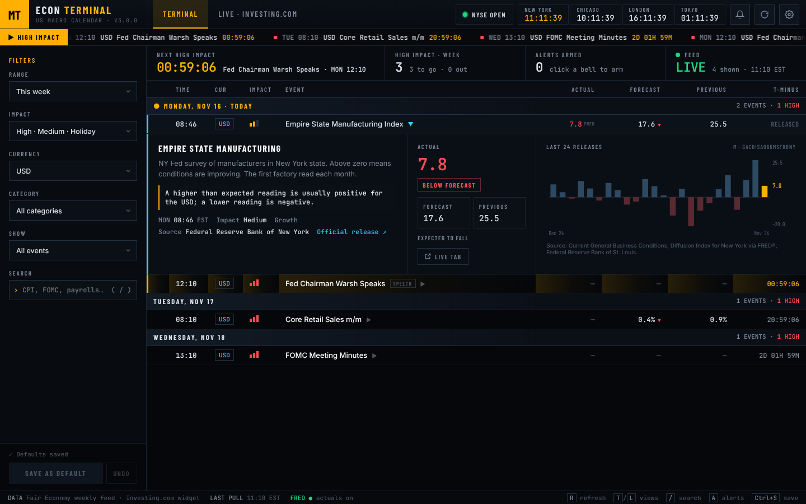

# MT Economic Calendar

A Wall Street style **US economic calendar** that runs in the browser. Countdown to the next high-impact release, a scrolling ticker, world clocks, NYSE session status, alerts, actual numbers, and a history chart for every major release. Nothing to install and no sign-up.



## Features

**Live calendar**
- Investing.com's official live calendar widget, US-only, with every event, forecast and actual as it prints
- Today / this week, importance filter, dark or light, and a pop-out window

**Dashboard panel** (right of the calendar)
- Next high-impact countdown, high-impact count for the week, alerts armed, feed status
- **Markets board** from TradingView's free widget: Dow, Nasdaq 100, S&P 500, VIX, SPY, QQQ, IWM, TLT, ES/NQ/YM e-minis, crude, gold, 2Y and 10Y yields, 10Y T-note futures and the dollar index
- High-impact ticker across the top, world clocks and NYSE session status

**Sidebar** (collapsible sections, closed until you open them)
- **Set alerts:** upcoming releases (High / High + Med / All), click to arm or remove an alert
- **Watch / listen:** this week's Fed speeches, press conferences and testimony, with ▶ WATCH when the Fed posts a stream and a YouTube live search otherwise

**Alerts** (`A`)
- A heads-up before release (1 to 30 min), an alert at release, and an alert when the actual posts (major releases, via FRED)
- Optional *Auto-alert every high-impact event*
- In-page banner and sound, plus optional desktop notifications while the tab is in the background

**Settings**
- Gear icon: install help, alerts, time zone, auto refresh. These save automatically.
- **Install as an app:** step-by-step help for iPhone/iPad, Android and PC/Mac, plus a one-click Install button where Chrome or Edge allows it
- Keyboard: `R` refresh · `A` alerts · `Ctrl+S` save defaults

**On phones**
- Same link, stacked for small screens: tiles, then the calendar, then markets; the sidebar slides out from the menu button
- Phones freeze web pages when you switch apps or lock the screen, so alerts only fire while the page is on screen. Use a computer for background alerts.

Everything you set is stored in your own browser. There are no accounts and the site collects nothing.

## Data sources

This site does not scrape anything.

| What | Source | Notes |
|---|---|---|
| Alert schedule, countdowns, ticker | [Fair Economy](https://www.faireconomy.media/) public weekly feed, the same feed behind Forex Factory's calendar export | Current week. Relayed through `/api/calendar` and cached for 10 minutes so the feed is requested rarely. |
| Actuals & history | [FRED®](https://fred.stlouisfed.org/), Federal Reserve Bank of St. Louis | Relayed through `/api/fred` with the site's key; visitors never need one. FRED usually posts within minutes of a release, and the site only shows a number once FRED has updated the series after the release time. Licensed surveys (ISM, UMich, NAHB, Conference Board) are not available. |
| Fed speech streams | [Federal Reserve Board calendar](https://www.federalreserve.gov/newsevents/calendar.htm) | Public US government page, read through `/api/fedcal` and cached 30 minutes. Adds a ▶ WATCH button to Board members' speeches when the Fed lists a stream. Regional Fed presidents get a YouTube live search instead. |
| Markets board | [TradingView](https://www.tradingview.com/widget/) free Market Quotes widget | Embedded with TradingView's attribution. Futures and some quotes are delayed. |
| Live calendar | [Investing.com](https://www.investing.com/webmaster-tools) embeddable economic calendar widget | Shown with Investing.com's attribution. Fastest place to see an actual print. |

This product uses the FRED® API but is not endorsed or certified by the Federal Reserve Bank of St. Louis. By using this site you agree to the [FRED® API Terms of Use](https://fred.stlouisfed.org/docs/api/terms_of_use.html).

All calendar data belongs to its providers. This project is not affiliated with Fair Economy, Forex Factory, Investing.com or the Federal Reserve Bank of St. Louis.

## Deploy your own copy (free, about 10 minutes)

The site is static HTML plus two small serverless functions, hosted on [Vercel](https://vercel.com/).

1. **Get a free FRED API key** at [fred.stlouisfed.org](https://fred.stlouisfed.org/docs/api/api_key.html). It's a 32-character code.
2. **Fork or push this repo** to your GitHub account.
3. In Vercel, choose **Add New → Project** and import the repo. Framework preset: **Other**. Leave the build settings empty.
4. Under **Environment Variables**, add `FRED_API_KEY` with your key.
5. Click **Deploy**. You get a link like `your-project.vercel.app` to share.

Every push to `main` redeploys automatically. Without `FRED_API_KEY` the site still works; actuals and history charts just stay blank.

To preview the page without deploying, open `public/index.html` straight from disk: it runs with sample data.

## Run it for another community (rebranding)

One codebase can power several branded sites. Each Vercel project picks its look with the `BRAND` environment variable, and every push to GitHub updates all of them.

Brands live in `api/_brands.js`. Each one sets the name, logo letters (or a logo image), header wordmark, light or dark theme, accent color, an optional community button (like a Discord invite), the About credit, and starting settings for new visitors.

To add a brand site:
1. Add an entry to `api/_brands.js` (copy `le` as a template) and put its icons in `public/brands/<id>/` (`icon-192.png`, `icon-512.png`, and optionally a square `logo.png`).
2. In Vercel, **Add New → Project**, import this same repo, and add two environment variables: `BRAND` = the brand id (e.g. `le`) and `FRED_API_KEY`.
3. Deploy. Each project gets its own link and its own settings.

Included brands: `mt` (default, dark terminal, amber), `le` (LE Trading Academy, light theme, purple) and `kt` (Kingdom Traders, deep navy with a purple frame and gold accents).

## Project layout

```
public/index.html       the terminal UI (HTML/CSS/JS)
public/indicators.js    event descriptions, sources and FRED series mappings
public/fonts/           bundled fonts (SIL OFL 1.1)
api/calendar.js         relays the weekly calendar feed (cached)
api/fred.js             relays FRED for the allowed series, keeps the key server-side (cached)
api/fedcal.js           reads the Fed Board's monthly calendar for speech stream links (cached)
api/brand.js            applies the site's brand (from BRAND) before the page draws
api/manifest.js         home-screen app name and icons for the site's brand
api/_brands.js          brand definitions
public/brands/          per-brand icons and logos
vercel.json             headers
```

When you add a FRED-backed event to `public/indicators.js`, add its series ID to the `ALLOWED` list in `api/fred.js`.

## License

MIT for the code. Bundled fonts under the SIL Open Font License 1.1. See `LICENSE`.
